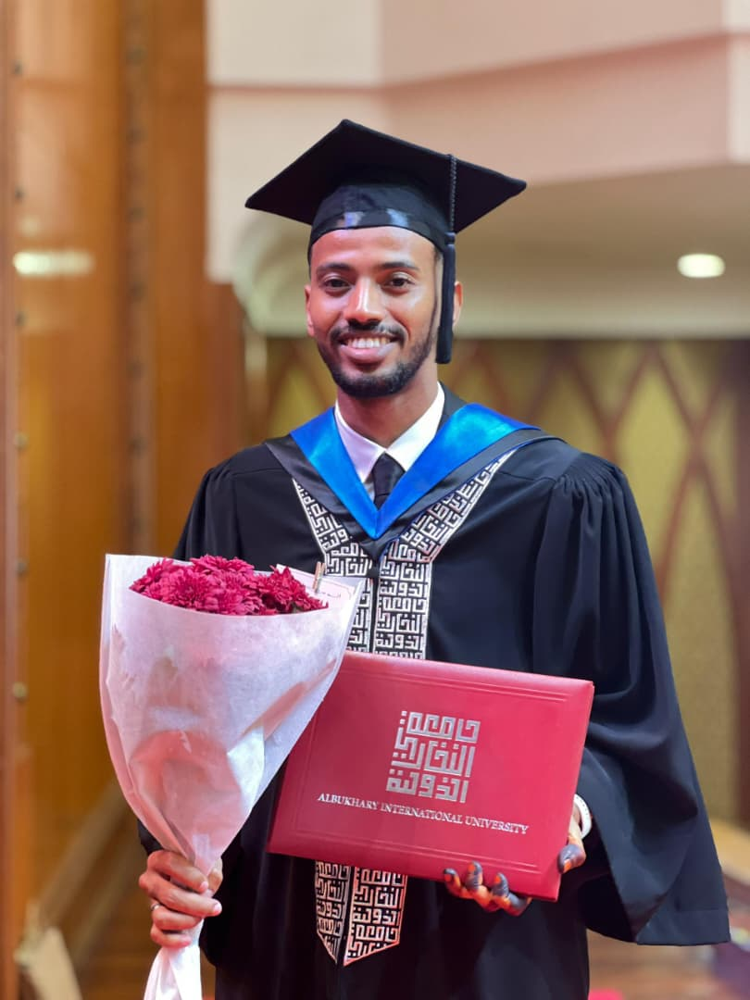
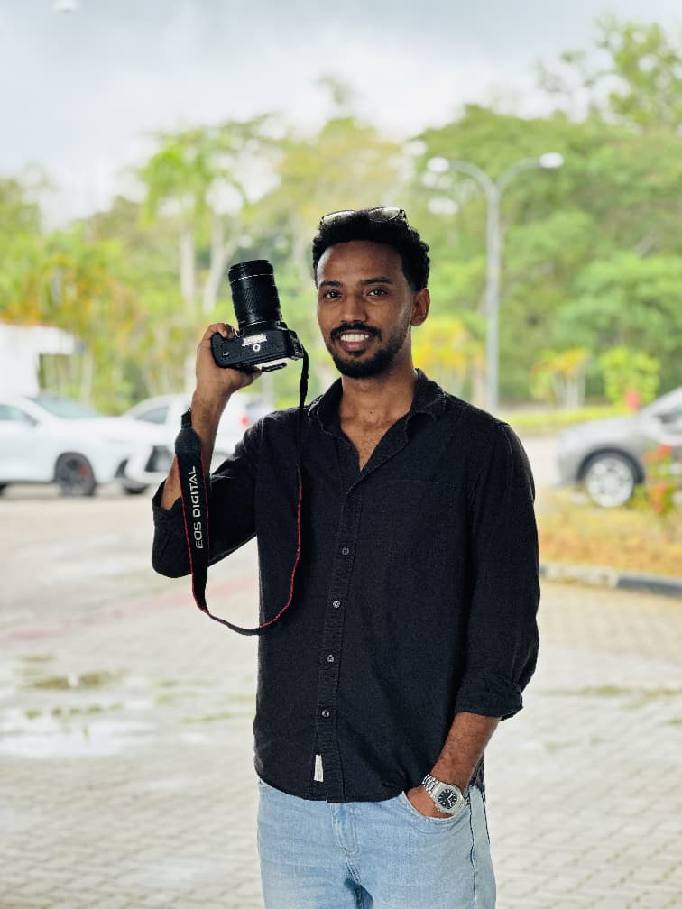
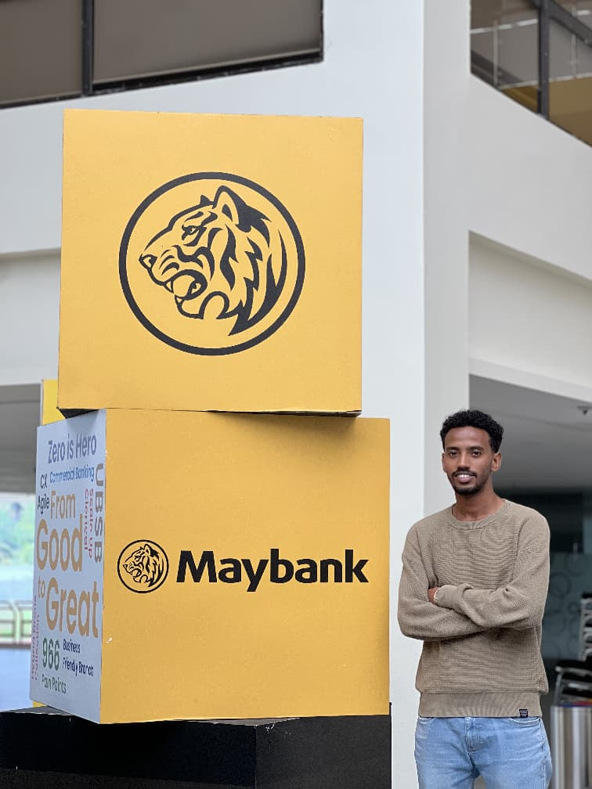
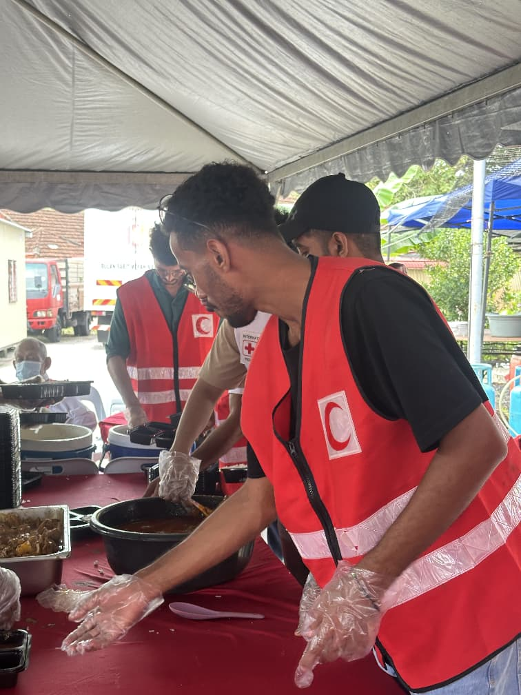
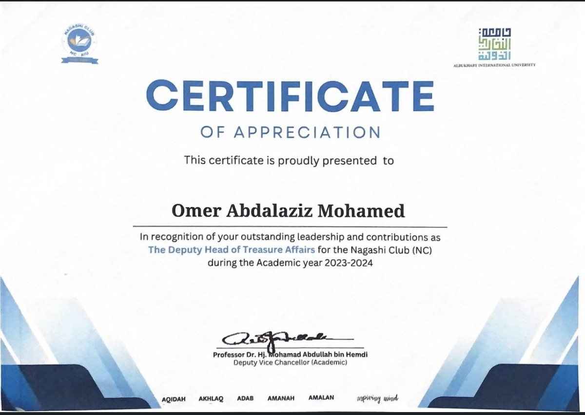
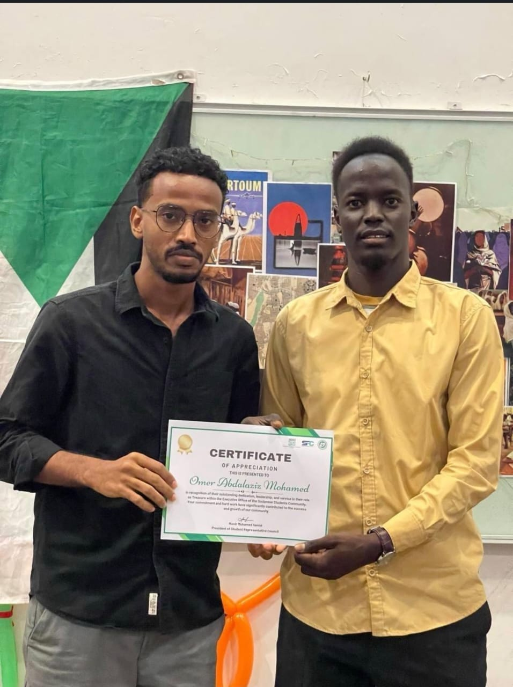
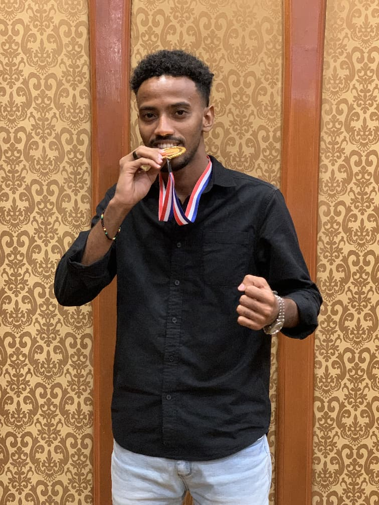
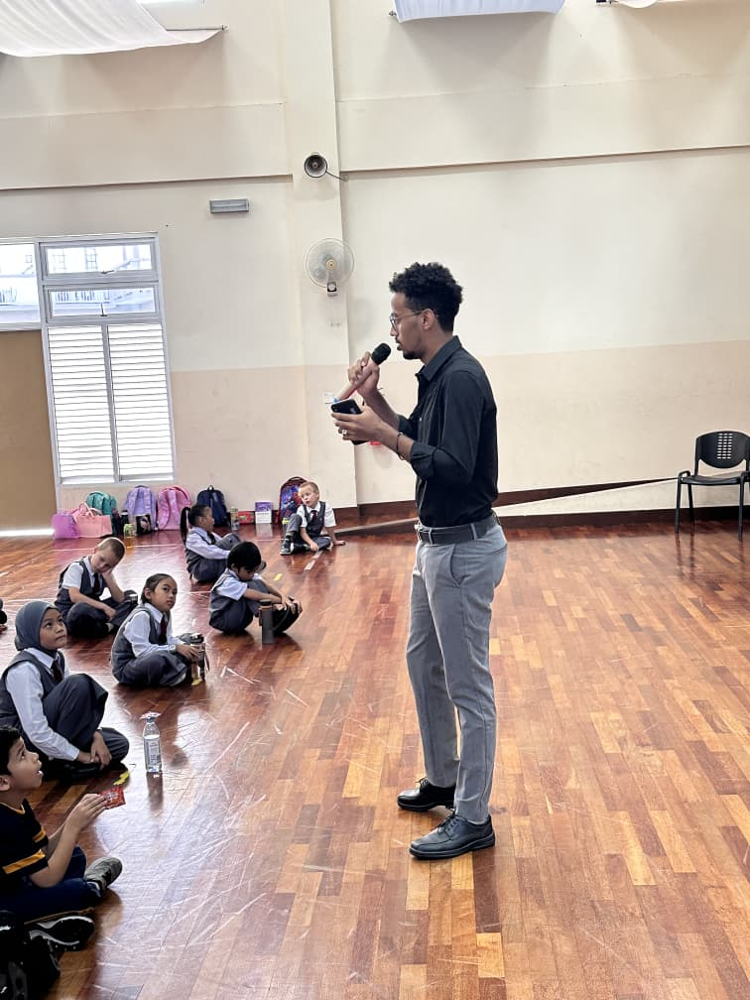

<div align="center">

# 💼 Omer Abdalaziz Mohamed
### **Executive HR & People Operations Portfolio**
**B.B.A. (Hons) in Human Resource Management** • *Albukhary International University (AIU)*  
📍 *Kuala Lumpur, Malaysia*

[](https://vitejs.dev/)
[](https://react.dev/)
[](https://developer.mozilla.org/)
[](https://vercel.com/)
[](https://www.linkedin.com/in/omer-abdalaziz-mohammed-93704b299)
[](https://wa.me/60174024189)

<br/>

[🌐 **View Live Website**](#-live-deployment) • [📄 **Download Resume (PDF)**](Resume-2.pdf) • [💼 **LinkedIn Profile**](https://www.linkedin.com/in/omer-abdalaziz-mohammed-93704b299) • [📧 **Email Omer**](mailto:omarabdalazizcr7@gmail.com)

---

</div>

## 📌 Executive Overview

This web application serves as the interactive professional portfolio for **Omer Abdalaziz Mohamed**, a Human Resource Management graduate from **Albukhary International University (AIU)**.

Engineered specifically for **HR Directors, Executive Recruiters, and People & Culture Leaders**, this platform demonstrates quantitative achievements, verified visual evidence, multilingual capabilities, and end-to-end competencies across corporate, nonprofit, and campus leadership roles.

### 🌟 Core Value Pillars

| Pillar | Quantitative Impact & Competency Highlights |
| :--- | :--- |
| **👥 People & Talent Operations** | Coordinated **70+ student leaders** and committee members across major academic, cultural, and corporate events. |
| **🤝 Community Relief & Logistics** | Supported **200+ vulnerable families** with food distribution and field operations during Malaysian Red Crescent flood relief missions. |
| **🏆 Award-Winning Execution** | **1st Place Winner** in the AIU Sustainability Business Competition & **2nd Place / Best Presentation** at UpSkillzone. |
| **🌐 Multilingual Fluency** | Native in **Arabic** & **Tigre**, Advanced Professional in **English**, Elementary in **Malay**. |

---

## 📸 Verified Evidence & Asset Mapping

Every credential, leadership engagement, and community milestone presented in this portfolio is substantiated by verified photographic evidence and official certificates:

| Preview | Asset | Milestone / Position | Verified Organization & Description |
| :---: | :--- | :--- | :--- |
|  | [`o6.jpeg`](o6.jpeg) | **BBA HRM Graduation** | Official graduation portrait with Albukhary International University degree honors. |
|  | [`o5.jpeg`](o5.jpeg) | **Campaign Support Intern** | Event coverage, photography setup, and logistics for the **Tun Razak Foundation**. |
|  | [`o3.jpeg`](o3.jpeg) | **Maybank Ambassador 2025** | Representing campus talent initiatives at the **Maybank** corporate brand showcase. |
|  | [`o2.jpeg`](o2.jpeg) | **Flood Relief Volunteer** | Direct field logistics and food aid delivery with **Malaysian Red Crescent**. |
|  | [`o8.jpeg`](o8.jpeg) | **Deputy Head of Treasury** | Certificate of Appreciation for financial oversight in the **Nagashi Club**. |
|  | [`o7.jpeg`](o7.jpeg) | **Head of Finance** | Executive Office Certificate of Appreciation for **Sudanese Students Community**. |
|  | [`o4.jpeg`](o4.jpeg) | **1st Place Winner** | Gold Medal victory celebration for campus-wide **Sustainability Initiative**. |
|  | [`o1.jpeg`](o1.jpeg) | **Workshop Facilitator** | Conducting interactive training and youth empowerment workshops for school students. |

---

## ✨ Key Portfolio Features

- ⚡ **Dynamic Hero Section**: Real-time metric counters highlighting cumulative leadership, relief impact, and academic distinction.
- 🎓 **Academic Foundation & Coursework**: Clear breakdown of specialized HR modules including Human Resource Planning (HRP), HR Development (HRD), Occupational Safety & Health (OSH), Compensation, and Performance Appraisals.
- 🌐 **Multilingual Proficiency Meters**: Visual meters displaying language proficiencies across Arabic, Tigre, English, and Malay.
- 💼 **Interactive Career Timeline**: Filterable experience categories (*All, Internship & HR, Corporate, Volunteer, Finance*) with impact bullet points and credential preview popups.
- 🏆 **Award-Winning Showcase**: Deep-dive presentation cards featuring dual-image sliders and competition achievement metrics.
- 📄 **Embedded PDF Resume Viewer**: Full-screen modal allowing recruiters to inspect and download [`Resume-2.pdf`](Resume-2.pdf) without navigating away.
- ✉️ **Interactive Contact Hub**: Direct email, WhatsApp instant chat links, Kuala Lumpur location card, and interactive confetti animation upon inquiry submission.

---

## 🛠️ Technology Stack

```
Frontend Architecture:
├── React 18.3.1          (Modern Component-Based UI)
├── Vite 5.4.21           (Next-Gen Frontend Tooling & Blazing Fast Bundler)
├── Framer Motion 11.2    (Smooth Micro-Interactions & Spring Animations)
├── Lucide React          (Crisp, Consistent Minimalist SVG Icons)
├── Canvas Confetti       (Interactive Submission Celebration FX)
└── Glassmorphism CSS     (Custom Design Tokens with HSL Color Themes & Responsive Layouts)
```

---

## 📂 Repository Structure

```text
My_portfolio/
├── public/                 # Static public assets
├── src/
│   ├── components/
│   │   ├── Navbar.jsx      # Glassmorphic header with navigation & CTA
│   │   ├── Hero.jsx        # Hero section with graduation profile (o6.jpeg) & metrics
│   │   ├── About.jsx       # Education, coursework & multilingual proficiency meters
│   │   ├── Experience.jsx  # Filterable timeline with certificates (o2, o3, o5, o7, o8)
│   │   ├── Projects.jsx    # Dual-image Sustainability showcase (o1 & o4) & UpSkillzone card
│   │   ├── Skills.jsx      # Categorized HR technical competencies & tools
│   │   ├── Contact.jsx     # Contact form, direct links & confetti submission
│   │   ├── Footer.jsx      # Footer links & smooth scroll-to-top button
│   │   └── ResumeModal.jsx # Fullscreen embedded viewer & downloader for Resume-2.pdf
│   ├── App.jsx             # Main layout orchestration
│   ├── main.jsx            # React root mount
│   └── index.css           # Design tokens, glassmorphism utilities & base styles
├── o1.jpeg - o8.jpeg       # High-resolution verified evidence photos & certificates
├── Resume-2.pdf            # Official Curriculum Vitae
├── index.html              # HTML entry point with Google Fonts (Plus Jakarta Sans & Inter)
├── vite.config.js          # Vite build configuration
├── vercel.json             # Vercel Single Page Application rewrite routing
└── package.json            # Dependencies, scripts & build configuration
```

---

## 💻 Local Development Setup

To run this portfolio locally on your machine:

1. **Clone the repository**:
   ```bash
   git clone https://github.com/omarabdalazizcr7-droid/My_portfolio.git
   cd My_portfolio
   ```

2. **Install dependencies**:
   ```bash
   npm install
   ```

3. **Start the local development server**:
   ```bash
   npm run dev
   ```
   Open **[http://localhost:5173](http://localhost:5173)** in your browser.

4. **Build production bundle**:
   ```bash
   npm run build
   ```
   *The compiled production-ready output will be generated in `dist/`.*

---

## 🚀 Live Deployment (Vercel)

This repository includes [`vercel.json`](vercel.json) pre-configured with SPA rewrites for seamless routing:

1. Go to [vercel.com](https://vercel.com) and log in with your GitHub account.
2. Click **Add New... ➔ Project**.
3. Under **Import Git Repository**, select **`My_portfolio`** and click **Import**.
4. Vercel automatically detects the Vite preset:
   - **Framework Preset**: `Vite`
   - **Root Directory**: `./`
   - **Build Command**: `npm run build`
   - **Output Directory**: `dist`
5. Click **Deploy**.

> **⚡ Continuous Deployment Active**: Any update pushed to the `main` branch automatically triggers a zero-downtime rebuild and instant update on Vercel.

---

## 👤 Candidate Contact & Professional Profiles

* **Candidate**: Omer Abdalaziz Mohamed
* **Role**: HR Assistant | HR Operations | Talent Acquisition & People Support
* **Email**: [omarabdalazizcr7@gmail.com](mailto:omarabdalazizcr7@gmail.com)
* **Phone / WhatsApp**: [+60 17-402 4189](https://wa.me/60174024189)
* **Location**: Kuala Lumpur, Malaysia
* **LinkedIn**: [Omer Abdalaziz Mohammed](https://www.linkedin.com/in/omer-abdalaziz-mohammed-93704b299)

---

<div align="center">
  <sub>Designed & Developed for Omer Abdalaziz Mohamed • Powered by React 18 & Vite.</sub>
</div>
